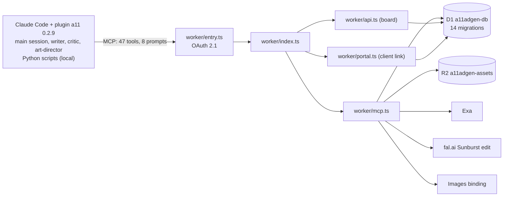
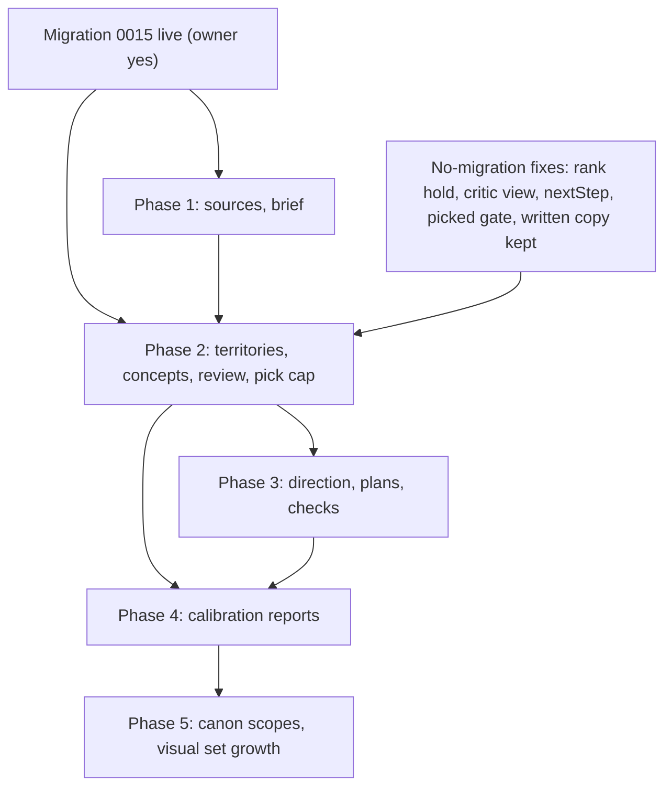

# a11-engine v3: Phase 0 repository audit

This document uses ASD-STE100 Simplified Technical English with British spelling.

It is the audit that `docs/a11-engine-v3.md` (the target specification) asks for in its Phase 0. It describes the code as it is, not the target. Every proposal in it is a proposal: nothing here is built. The detailed designs are in `docs/a11-engine-v3-fable-design-pack.md`. The start prompt for the implementation is `docs/a11-engine-v3-opus-kickoff.md`.

Legend: **Verified** = read in the source or measured in this audit. **Live read** = read from the live Worker with a free, read-only MCP tool on 16-11-2026 (UTC). **Not verified** = taken from a document only.

---

## 1. Repository identity and current state

| Item | Value |
|---|---|
| Repository | `han669669/a11-adgen` (public) |
| Product name | a11-engine (new name; the repository, the Worker `a11adgen` and the live URL keep their names) |
| Audit date | 16-11-2026 (UTC), 17-11-2026 SGT |
| Working tree before the audit | Clean. No user changes. |
| Open pull requests | None (GitHub, read 16-11-2026) |
| Remote branches | `main`, `claude/project-thread-zjydj1` (same commit as `main`) |
| Baseline check | `npm ci && npm run check` on `860eb9f`: exit 0. 26 test files, 464 tests passed. Vite build passed. Wrangler dry run: 395.18 KiB, gzip 148.07 KiB. |
| Live system | Phases 0 to 2 of the old plan are done and live. Phase 3 (client side) is built and on hold. No paying client. |

The Worker bundle is now 395 KiB minified. `AGENTS.md` §5 and §7 say 372 KiB (measured 11-11-2026). The number in `AGENTS.md` is stale.

## 2. Branch and commit

| Item | Value |
|---|---|
| Audited commit | `860eb9faa04cb3b059cb7f447b85d2fc23d2b748` (`origin/main`, PR #87) |
| Work branch | `docs/a11-engine-v3-preparation`, made from `origin/main` at that commit |
| Latest relevant commits | #87 logo centring and "not the logo's face"; #86 reprint colour; #85 planned layouts and real print; #84 real-camera finish; #83 display type |

If `origin/main` is not at `860eb9f` when the implementation starts, read the commits after it before you trust a line number below.

## 3. Architecture map



| Part | Source | Verified behaviour |
|---|---|---|
| Entry and OAuth | `worker/entry.ts`, `worker/oauth.ts`, `worker/auth.ts` | OAuth 2.1 provider in front of `/mcp`; web app sign-in with email, password and allow-list. |
| Router | `worker/index.ts:89-151` | `/mcp`, `/admin/*` (owner token), `/up/<token>` (one-time upload), `/api/*`, `/c/<token>` (portal), `/m/<key>` (pictures), else the web app from R2 `app/`. |
| MCP server | `worker/mcp.ts` (1,145 lines) | Hand-written, stateless. 47 tools (`TOOLS`), server instructions at `:30-31`. It calls no LLM. |
| MCP prompts | `worker/prompts.ts` | 8 prompts: `brand`, `batch`, `redesign`, `final`, `pack`, `learn`, `results`, `gold-test`. Each is prose that names tools and steps. |
| Plugin | `plugin/agents/*.md`, `plugin/commands/*.md`, `plugin/.claude-plugin/plugin.json` | 3 subagents, 8 short commands that call `prompt_get`. Version 0.2.9. |
| Batch logic | `worker/batch.ts` (545 lines) | Subjects, facts, batches, ideas, picks, ranks, verdicts, `taste_log`, `final_render`, `batch_get`. |
| Learning | `worker/canon.ts` | Canon rules, canon log, swipe file, gold set and gold runs. |
| Paid calls | `worker/exa.ts`, `worker/fal.ts`, `worker/spend.ts` | Every Exa and fal call reserves and settles a row in `spend` against `SPEND_CAP_USD` (100.00 per month). |
| Images | `worker/compose.ts`, `worker/food.ts`, `worker/paste.ts`, `worker/uploadlink.ts` | Logo compose with the Images binding; mask repairs with paste-back; one-time upload links. |
| Client side | `worker/pack.ts`, `worker/portal.ts`, `worker/comments.ts`, `worker/uploads.ts`, `worker/results.ts`, `worker/xlsx.ts`, `worker/picks.ts` | Packs, portal page, comments, uploads, results ledger, `picks_get`. |
| Web app | `app/src/views/Batches.tsx`, `Board.tsx`, `SignIn.tsx` | Three views only: sign-in, batch list, draft-pick board. |
| Local image scripts | `scripts/product_lock.py` (748 lines), `headline.py`, `photo_finish.py`, `box_print.py`, `food_grade.py` | Run in the Claude Code session, not in the Worker. Tested by `scripts/test_scripts.py` on synthetic pictures. |
| CI | `.github/workflows/check.yml` | `npm run check` (typecheck, tests, build, dry run) and the Python script tests, on every PR and on `main`. |
| Deploy | `wrangler.jsonc`, `docs/deploy.md` | A commit on `main` deploys the Worker (Workers Builds). D1 migrations and the web app files are manual and need the owner. |

### 3.1 Batch state today

`batches.status` has a CHECK constraint with six values (`migrations/0002_core.sql`): `research`, `ideas`, `drafts`, `board`, `finals`, `done`. Only two transitions are in code: `batch_update` to `board` is gated (`worker/batch.ts:141-158`), and `final_render` moves `drafts` or `board` to `finals` (`worker/batch.ts:439,472`). All other transitions are whatever the agent sends. The prompts hold the order of work.

A stopped session resumes with `batch_get`: "find the last step that finished" (`worker/prompts.ts:57`). The server gives no next step for a batch. `picks_get` does give a `next` field for each pick (`worker/picks.ts:74-82`).

## 4. Existing capability inventory

| Capability | Where | State |
|---|---|---|
| Brand kit, versioned, never changed in place | `worker/brand.ts`, `worker/brandextract.ts`, table `brand_kits` | Live. The kit JSON holds logo, palette, fonts, voice, neverSay, refs, placement, food words and notes. |
| Subject (product, brand, redesign) | `subjectSave`, table `subjects` | Live. Redesign pictures kept in R2. |
| Fact sheet | `factsSave`, table `facts` (`label`, `value`, `quote`, `source_url`, `created_at`) | Live. The server does not check that the quote is on the page. |
| Research | `exa_search`, `exa_contents` (`worker/mcp.ts:67-98`, `worker/exa.ts`) | Live. Results go to the agent only. The server keeps the query and the cost in `spend`, not the result. |
| Insight sheet | `batches.insights` JSON: up to 20 items of `truth`, `sourceUrl`, optional `quote` (`worker/mcp.ts:279-292`) | Live. Flat list. No confidence, no evidence type, no unknowns. |
| Idea burst | `ideas_save` (`worker/mcp.ts:320-361`): `format`, `insight`, `sourceUrl`, `visual`, `headline`, `copy` | Live. 24 to 30 ideas, at least 8 per stage (prompt). |
| Idea pick | `ideas_pick` (`worker/mcp.ts:363-376`, `worker/batch.ts:267-277`) | Live. 1 to 3 ids. It saves no reasons. |
| Copy review | `ideas_update copyApproved`, `copyApprovedCheck` (`worker/batch.ts:252-265`), gate in `render_submit` (`worker/mcp.ts:827`) | Live. A draft render is refused without the owner's approval of the words as they are now. |
| Drafts and finals | `render_submit`, `final_render`, `render_status` | Live. Draft 1024x1280 low, final 1536x1920 high. |
| Blind draft rank | `drafts_rank`, table `draft_ranks` | Live. See §8 for the limits of "blind". |
| Owner draft pick | `picks_save`, `POST /api/batches/:id/picks`, table `picks` | Live. |
| Owner verdicts | `batch_update ownerVerdicts`, table `verdicts` (migration 0014) | Live. 49 rows (live read). |
| Taste log | `tasteLog` (`worker/batch.ts:367-411`) | Live. |
| Canon | `canon_get`, `canon_update`, tables `canon_rules`, `canon_log` | Live. 26 active rules (live read). |
| Swipe file | `swipe_add`, `swipe_search`, table `swipe` | Live. |
| Gold set | `gold_import`, `gold_get`, `gold_score`, `gold_runs` | Live. 264 text items, 4 runs (live read). |
| Product lock, reprint, finish, type, box print | `scripts/*.py`, playbook §7.4 to §7.7 | In use. Local scripts. |
| Logo compose, food and region repair | `compose_final`, `food_fix`, `region_fix`, `final_attach`, `upload_link` | Live. |
| Packs and portal | `pack_publish`, `pack_update`, `pack_revoke`, `picks_get`, `/c/<token>` | Live. Three test links exist; W47 v3 must stay live and unchanged. |
| Results ledger | `baseline_save`, `results_save`, `results_get`, `uploads_get`, `comments_get` | Built. No real client data. |
| Spend ledger | `worker/spend.ts`, `spend_get` | Live. |

## 5. Reuse, change and build matrix

Classes: KEEP, EXTEND, REPLACE, BUILD, DEFER, CONFLICT. The proposed actions are specified in the design pack (DP).

| V3 requirement (section) | Current implementation | Evidence | Class | Proposed action | Dependencies |
|---|---|---|---|---|---|
| Fixed stack; MCP calls no LLM (§2) | As required | `worker/mcp.ts`, `AGENTS.md` D1 | KEEP | None | None |
| Free plan limits (§2.1) | Small Worker work, pixels in fal and local scripts | `worker/fal.ts`, `scripts/` | KEEP | Recheck the limits before Phase 1 code; update the bundle size in `AGENTS.md` | None |
| Creative Strategy Brief (§4.1) | Flat insight list in `batches.insights`; facts in `facts` | `worker/mcp.ts:279-292` | BUILD | A versioned brief record with evidence, basis, confidence and unknowns (DP 1) | Migration 0015 |
| Research provenance, exact quotes, retrieval date (§4.2, §4.3) | The agent types the quote and URL. Research results are not stored. | `worker/exa.ts:31-75`, `worker/batch.ts:43-55` | EXTEND | Store what Exa returned for a batch; mark each quote as found or not found in the stored text (DP 1.4) | Migration 0015 |
| Direct evidence, interpretation, hypothesis kept apart (§4.2) | Not present | `worker/mcp.ts:283-287` | BUILD | A `basis` field on every insight (DP 1.3) | Brief record |
| Only verified facts in copy (§4.3) | Number check in `pack_publish` for Meta text only | `worker/pack.ts` (hard check 1) | KEEP, EXTEND | Keep. The critic checks the picture copy against the facts by reading, as now. | None |
| Concept territories, 3 to 5 (§5.1) | Not present | `worker/mcp.ts:320-361` | BUILD | Territories saved with the concepts (DP 2.2) | Migration 0015 |
| Full concept record (§5.2) | An idea has `insight`, `visual`, `headline`, `copy` | `migrations/0004_funnel.sql` | EXTEND | One new JSON column `ideas.concept` (DP 2.3) | Migration 0015 |
| Fewer, deeper concepts (§5) | 24 to 30 ideas, at least 8 per stage | `worker/prompts.ts:57`, `plugin/agents/writer.md:11` | REPLACE | 6 to 15 concepts in 3 to 5 territories | Owner decision C1 (§19) |
| Select the best three, funnel role after (§5.4) | One pick per stage, forced in 4 layers | §6 below | REPLACE | Remove the per-stage limit; keep a limit of 3 per batch (DP 2.6) | Migration 0015; owner decision C1 |
| Independent critic in a fresh context (§6.1) | Subagent with its own tools; the context rule is prose | `plugin/agents/critic.md` | KEEP, EXTEND | A critic view of the batch from the server (DP 2.5) | None |
| Critic records its reasons (§6.1) | No record for the idea pick | `worker/batch.ts:267-277` | BUILD | A concept review record saved with the pick (DP 2.5) | Migration 0015 |
| Critic can reject the whole set (§6.1) | Prose only; `ideas_pick` needs at least 1 id | `worker/mcp.ts:371` | BUILD | `outcome: "rework"` in the review (DP 2.5) | Migration 0015 |
| 1 to 5 rating on 9 dimensions (§6.2) | Not present (the option B test: 4 yes/no questions) | `docs/creative-playbook.md` §2 | BUILD | The rating lives in the review record. The option B test and the owner gate stay as gates. | Review record |
| Hard rejection gates (§6.3) | In prose (critic, playbook, taste seed) | `plugin/agents/critic.md:11` | KEEP | No new code check. Budget: 15, today 3 in code. | None |
| Product truth (§7.1) | Product lock, reprint, real logo, kit versions | `scripts/product_lock.py`, playbook §7.4 | KEEP | None. The new direction record feeds the same scripts. | None |
| Visual direction per concept (§7.2) | The art director writes prompts and plans; nothing is saved | `plugin/agents/art-director.md`, `worker/prompts.ts:57` | BUILD | A direction record per picked concept, with the 3 layout plans (DP 3) | Migration 0015 |
| House recipe as fallback, not the rule (§7.2) | "The house recipe is the standard"; one look per stage | playbook §7, §7.2; `art-director.md:13` | EXTEND | The look comes from the concept, not from the stage | Owner decision C5 |
| Three different drafts (§7.3) | Three skeleton placements per idea | playbook §7.4 A step 1 | EXTEND | A diversity rubric and a stated question per draft (DP 3.4) | Direction record |
| Draft review; weak drafts rejected before the owner (§7.4) | The art director reports in chat; nothing is saved | `art-director.md:17` | EXTEND | A saved check per draft; the board and the sheet show only eligible drafts (DP 3.6) | Migration 0015; board change in Phase 6 |
| Owner does not see the rank before he picks (§7.5) | The board hides it in the browser; the server sends it | `worker/batch.ts:529`, `Board.tsx:129-146` | EXTEND | The server withholds rank and reason until the owner decides (DP 4.3) | None |
| Owner picks 1 of 3 or passes; exact words saved (§7.5) | As required | `picksSave`, `verdictInserts` | KEEP | None | None |
| Final render path, 4:5, 1536x1920, logo in code (§7.6) | As required. Since 16-11-2026 the final picture is built in code after `compose_final` with grain off. | playbook §7.4 step 6, §7.7 | KEEP | None | None |
| Food authenticity (§7.7) | Food truth stage, `food_fix`, `region_fix` as rare repairs | playbook §6 | KEEP | None | None |
| Final quality gate, 8 points (§7.8) | Prose check by the art director; not saved | `worker/prompts.ts:83` | EXTEND | A saved final check (DP 3.6) | Migration 0015 |
| Copy standards (§8) | Playbook §8, copy review gate | `worker/batch.ts:252-265` | KEEP, CONFLICT | Keep the owner's standard. Two points of §8 conflict with it (C3, C4). | Owner decision |
| Owner taste store (§9.1) | `picks`, `verdicts`, `taste_log`, canon | §9 below | KEEP | None | None |
| Brand, product, creative, performance stores kept apart (§9.2 to §9.5, §9.7) | One canon with a `stage` field only; kit notes; facts; swipe; results | `migrations/0006_canon.sql` | EXTEND | A scope on each canon rule (Phase 5, Opus). Mapping in §9. | A later migration |
| Customer voice excluded (§9.6) | Not built | | KEEP | Do not build | None |
| Learning change record with 10 fields (§9.7) | `canon_log` holds action, detail, time | `worker/canon.ts:73-74` | EXTEND | Phase 5, Opus | A later migration or JSON in `detail` |
| Reversible canon (§9.8) | Retire and restore are logged. An edit keeps the old text in the log. No one-step undo. No canon view in the web app. | `worker/canon.ts:95-137`, `app/src/views/` | EXTEND | Phase 5, Opus. The blueprint line "the owner can undo any change on the board" is not true today. | None |
| Text gold set kept apart from visual (§10.1) | 264 items, no pictures | §10 below | KEEP | Label it as text-only in every report | None |
| Visual gold set (§10.2) | Not present | | BUILD | DP 4.5 | Phase 4 |
| Critic calibration and metrics (§10.3, §10.4) | One number: rank-1 agreement (`tasteTally`) | `worker/batch.ts:355-361` | BUILD | DP 4 | Records from Phases 1 to 3 |
| Resumable batch state (§11.2) | Status plus what `batch_get` shows; plans and checks live only in the session | §3.1 | EXTEND | Records in D1 and a server `nextStep` (DP 0.3) | Migration 0015 |
| MCP names consistent; plugin updated with contracts (§11.3) | A test checks that every named tool exists | `tests/mcp.test.ts:127-166` | KEEP | Keep the tests; bump the plugin version with each contract change | None |
| Client deliverables (§13) | As required | `worker/pack.ts`, `worker/portal.ts` | KEEP | No change. Ad names keep their form (§7.3). | None |
| Security, spend, live changes, deploy (§14) | As required | `docs/security-checklist.md`, `worker/spend.ts`, `docs/deploy.md` | KEEP | None | None |
| Restaurant plates, services, 9:16, private customer data, Meta account access (§18) | Parked or not built | `docs/backlog.md` | DEFER | None | Owner |

## 6. Funnel constraint investigation

The rule "one picked idea per funnel stage" is forced in four layers, and stated in three more.

### 6.1 Every location

| Layer | Location | What it does |
|---|---|---|
| D1 trigger | `migrations/0004_funnel.sql:29-34` `ideas_pick_limit_insert` | Aborts an insert of a picked idea when the batch has a picked idea of that `format`. |
| D1 trigger | `migrations/0004_funnel.sql:36-41` `ideas_pick_limit_update` | The same on an update of `picked`, `format` or `batch_id`. |
| D1 (removed) | `migrations/0002_core.sql:81` unique index `ideas_one_pick_per_format` | Gone since 0004 (the table was rebuilt). Named here so nobody looks for it. |
| Worker gate | `worker/batch.ts:141-150` | `batch_update status: "board"` needs exactly one picked idea for each of `tof`, `mof`, `bof`. Batches with no funnel ideas are exempt. |
| Worker constant | `worker/batch.ts:6-7` `FORMATS` | Feeds the `ideas_save` enum and the gate. |
| MCP text | `worker/mcp.ts:31` (instructions), `:322` (`ideas_save`), `:365` (`ideas_pick`: "at most 1 tof, 1 mof, 1 bof"), `:371` (1 to 3 ids), `:380` (`ideas_update`) | Tells the agent the rule. |
| Prompts | `worker/prompts.ts:47` (batch description), `:57` (batch: "at least 8 per funnel stage", "picks 3 (1 tof, 1 mof, 1 bof)", "2 spare ideas per stage", "the pick limit is 1 per stage, so unpick the first"), `:76` (redesign, the same) | Tells the agent the rule. |
| Subagents | `plugin/agents/critic.md:3,11` ("Choose 1 tof, 1 mof and 1 bof"), `plugin/agents/writer.md:3,11` ("at least 8 ideas for each stage"), `plugin/agents/art-director.md:13` ("Give each stage its own backdrop") | Tells the subagents the rule. |
| Plugin command | `plugin/commands/batch.md:2` (description) | Text only. |
| Documents | `AGENTS.md` §2; `docs/blueprint.md` §3 step 6; `docs/creative-playbook.md` §3, §5; `docs/decisions.md` row 2026-11-07 "Formats become funnel stages" | The owner's decision of 07-11-2026. |
| Tests | `tests/batch.test.ts:51-66` (seed helper), `:304-314`, `:316-330`, `:487-493`, `:495-502`; `tests/migrations.test.ts:9-41` | Expect "Pick limit" errors and the board gate. |
| Frontend | `app/src/views/Board.tsx:8-17,119` | Shows the stage as a badge. It does not assume one per stage. It counts "n of ideas picked". `POST /api/batches/:id/picks` takes 0 to 8 picks (`worker/api.ts:120`). |

### 6.2 What does not depend on one idea per stage

| Part | Evidence | Result |
|---|---|---|
| Ad names | `worker/pack.ts:61-63`: week, brand, batch number, stage, idea number, version | Two ads of one stage get different idea numbers, so names stay unique. |
| `pack_update` match | `worker/pack.ts` `adKey`: stage and idea number | Works with any mix of stages. |
| `copyFromVersion` | `worker/pack.ts:136` matches by stage and idea number | Works. |
| Results | `worker/results.ts:12` `AD_NAME_PATTERN`: stage is `[a-z]+` | Works. |
| Portal | `worker/portal.ts:9` stage labels | Shows a label for each ad. Two ads can show the same label. |
| Canon, swipe, gold | `stage` columns | A label only. |

One thing does depend on a stable stage: after a pack is published, the stage is part of the ad name. If an idea's `format` changes after `pack_publish`, a later `pack_update` or `copyFromVersion` no longer finds the ad. So the funnel role must be fixed before the first pack of a batch. Today nothing in code stops a later change.

### 6.3 Historical records

Live read, 16-11-2026: 9 batches. Three are from before the funnel stages or from its first day (`W46 Pop Barley Caramel` with the four old formats, `W46b`, `W46c`). All later batches have one pick per stage. Every historical row already satisfies any weaker rule, so no data change is needed. Packs of batch `c8cd20a6` (W47 Cat & the Fiddle, versions 1 to 5) use the stage in their ad names; they are not touched.

### 6.4 Smallest safe schema change

Drop the two triggers and put in two triggers that keep a limit of 3 picked funnel ideas per batch. This is one migration with no table rebuild and no change to any row.

```sql
-- Proposal only. Not applied. Part of migration 0015 (design pack 0.2).
DROP TRIGGER ideas_pick_limit_insert;
DROP TRIGGER ideas_pick_limit_update;
CREATE TRIGGER ideas_pick_cap_insert BEFORE INSERT ON ideas
WHEN NEW.picked = 1 AND NEW.format IN ('tof', 'mof', 'bof')
 AND (SELECT COUNT(*) FROM ideas WHERE batch_id = NEW.batch_id AND picked = 1) >= 3
BEGIN SELECT RAISE(ABORT, 'Pick limit: 3 ideas per batch.'); END;
CREATE TRIGGER ideas_pick_cap_update BEFORE UPDATE OF picked, batch_id ON ideas
WHEN NEW.picked = 1 AND NEW.format IN ('tof', 'mof', 'bof')
 AND (SELECT COUNT(*) FROM ideas WHERE batch_id = NEW.batch_id AND picked = 1 AND id != NEW.id) >= 3
BEGIN SELECT RAISE(ABORT, 'Pick limit: 3 ideas per batch.'); END;
```

The old-format batch (four picks, formats `hook` to `offer`) is exempt because the new triggers look only at funnel formats.

### 6.5 Compatibility, sequence and rollback

1. The migration is safe with the old code: the old Worker gate (`worker/batch.ts:141-150`) and the old prompts still give one pick per stage. So the migration goes live first, with the owner's yes.
2. Then the code merges. New batches carry a marker (`batches.engine = 3`, design pack 0.2). The board gate keeps the old rule for a batch with `engine = 2` and uses "exactly 3 picked" for `engine = 3`. A batch that is in work at the change keeps its old rule to the end.
3. Rollback of the code: revert the PR. Old code runs on the new schema.
4. Rollback of the schema: a new migration that drops the two new triggers and creates the two old ones again. A trigger checks only new writes, so rows of `engine = 3` batches with two picks in one stage stay as they are. No data is lost in either direction.

## 7. D1 and compatibility analysis

### 7.1 Schema today (14 migrations)

`spend`, `renders` (0001); `brands`, `brand_kits`, `subjects`, `facts`, `batches`, `ideas`, `draft_ranks`, `picks` (0002, `ideas` rebuilt in 0004, `picks.by_owner` in 0005); `users`, `sessions`, `login_failures`, `renders.composed_key` (0003); `canon_rules`, `canon_log`, `swipe`, `gold_items`, `gold_runs` (0006, 0008); `packs` (0007); `baselines`, `results` (0009); `comments` (0010); `uploads` (0011); `upload_links` (0012); `pack_updates` (0013); `verdicts` (0014).

### 7.2 Map of the v3 logical entities

| V3 entity (§11.1) | Today | Gap |
|---|---|---|
| Brand, brand kit version | `brands`, `brand_kits` | None |
| Product | `subjects` (kind `product`) | A product is saved again for each batch (`subject_save` in the batch prompt). There is no lasting product row across batches. See §9. |
| Product facts | `facts` (by subject) | No status field: a row means "verified by quote". No check of the quote. |
| Product references | Kit JSON: packshot and texture refs, notes with measured boxes | Measurements live in free-text kit notes and in playbook §7.4 tables. |
| Research source | None | BUILD |
| Buyer insight | `batches.insights` JSON | EXTEND into the brief |
| Strategy brief | None | BUILD |
| Concept territory | None | BUILD |
| Concept | `ideas` | EXTEND |
| Creative direction | None (chat and session files) | BUILD |
| Draft, final | `renders` | None |
| Draft rank | `draft_ranks` | None |
| Pick | `picks` | None |
| Verdict | `verdicts` | None. Do not create a second table. |
| Canon rule | `canon_rules`, `canon_log` | No scope field (§9) |
| Swipe item | `swipe` | None |
| Gold item | `gold_items`, `gold_runs` | One set only; a run must answer every item (`worker/canon.ts:263-264`) |
| Results record | `results`, `baselines` | None |
| Pack | `packs`, `pack_updates` | None |
| Spend record | `spend` | None |

### 7.3 Constraints that shape the design

- `batches.status` is a CHECK list. A new status value needs a table rebuild. The design adds no status value; it derives a finer step from saved records.
- `ideas.format` is NOT NULL with a CHECK list. The design keeps it as the funnel role, so every concept carries one of `tof`, `mof`, `bof`.
- `ideas_save` and `batch_get` are bounded: 40 ideas per call, 60 ideas read per batch (`worker/batch.ts:492`), 150 renders per batch.
- `AGENTS.md` §7: a merge deploys at once and the migration does not run by itself. Code must work before and after its migration, or merge after it.
- The live database is the only one with real data. The preview Worker has its own D1 for migration tests.

## 8. Critic and agent investigation

| Question | Finding | Evidence |
|---|---|---|
| Does each agent have its own context? | Yes with the plugin: each subagent call starts fresh. The rule "give it only the batch id" is prose in the prompts. Without the plugin the prompt says "a fresh session", which nothing checks. | `worker/prompts.ts:57`, `plugin/agents/critic.md:3,7` |
| Writer inputs and tools | `batch_get`, `canon_get`, `swipe_search`, `taste_log`, file reads. It cannot save; the main session saves the burst. | `plugin/agents/writer.md:4` |
| Critic inputs and tools | `batch_get`, `canon_get`, `taste_log`, `image_get`, `ideas_pick`, `drafts_rank`, `gold_get`, `gold_score`, file reads. No paid tool. No tool that writes ideas, prompts or verdicts. | `plugin/agents/critic.md:4`, `tests/mcp.test.ts:184` |
| Art-director inputs and tools | File reads, Bash (for the scripts), `batch_get`, `brand_get`, `canon_get`, `image_get`, `render_status`. No paid tool, no write tool. | `plugin/agents/art-director.md:4` |
| Is the critic independent? | In its tools, yes. In what it reads, partly: `batch_get` returns the batch `notes`, which the main session writes, and the ideas in the writer's order. | `worker/batch.ts:512-513` |
| Can it reject the whole set? | Only in words: "If fewer than 3 survive, say so and ask for more ideas." Nothing is saved, so a later session cannot see that a set was rejected or why. | `plugin/agents/critic.md:11` |
| Can it inspect ideas before paid rendering? | Yes. But the paid gate is the copy approval only: `render_submit` does not check that the idea is picked. An idea that is not picked, with approved words, can be rendered. | `worker/mcp.ts:827`, `worker/batch.ts:252-265` |
| Does it record why it picked? | No. `ideas_pick` takes ids only. | `worker/batch.ts:267-277` |
| Is the draft rank hidden from the owner? | In the browser, yes: the board shows rank and reason only for an idea that has a saved pick. The server sends `rank` and `reason` with every draft, to the board and to every MCP caller. In chat, the rule is prose ("do not read its rank before the owner picks"). | `Board.tsx:71,129-146`, `worker/batch.ts:529` |
| Does the art director have what its checks need? | It can read pictures up to 3 MB with `image_get` and run the scripts. It cannot save a check, so its findings live only in its report. A final built in code is checked from the local file. | `art-director.md:17`, `worker/prompts.ts:83` |
| How good is the blind rank? | Live read: the owner's pick was the critic's rank 1 in 2 of 12 ranked picks (rank 2: 6, rank 3: 4). Chance is 1 in 3. With 12 cases the 95% interval is about 0.05 to 0.45, so the data do not show that the rank is worse than chance, and they do not show that it is better. | `taste_log` tally |

What must change: a saved review for the concept pick (with a whole-set reject), a server view for the critic that leaves out the main session's notes and old ranks, a server-side hold on rank and reason, a gate so that only a picked concept is rendered, and saved checks for drafts and finals.

## 9. Learning investigation

### 9.1 What exists

| Store | Tables and tools | Verified behaviour |
|---|---|---|
| Owner draft picks | `picks` (`by_owner` 1), `picks_save` | 17 owner picks (live read). `picks_save` returns the critic's rank for each pick and the running tally. |
| Owner verdicts | `verdicts`, `batch_update ownerVerdicts` (`worker/batch.ts:94-134`) | 49 rows (live read): final approve 14, fix 13, reject 8; draft pass 7, fix 5; 2 old rows with a source mark only. 16 rows name a picture. Rows are only added. |
| Migration 0014 | `migrations/0014_verdicts.sql`, `docs/design/owner-verdicts.md` | Live since 12-11-2026. The backfill ran once (21 rows). Do not run either again. No second verdict table is needed. |
| Taste log | `tasteLog` | Returns the tally, the newest verdicts and the newest picks with the chosen and passed drafts and the critic's rank and reason. |
| Canon | `canon_rules`, `canon_log` | 26 active rules, limit 40 by trigger. Each rule has `stage`, evidence JSON, hits, misses. Almost all rules have 0 hits and 0 misses (live read): the hit rate is not in real use. |
| Swipe file | `swipe` | `brand_slug`, `stage`, `title`, `why`, `source`, `image_key`. |
| Gold set | `gold_items`, `gold_runs` | §10. |
| Results | `results`, `baselines` | Keyed by ad name, which holds the pack version. No rows from a real client. |
| Copy approval | `ideas.copy.ownerApproved` | Holds the approved words and the owner's words. When the owner changes a headline, `ideas_update` writes over the old headline (`worker/batch.ts:226-227`): the words as written are lost, so a copy correction rate cannot be computed from history. |

### 9.2 How the five stores map

| V3 store | Today | Mixed with | Proposed separation (Phase 5, Opus) |
|---|---|---|---|
| 1. Owner taste | `picks`, `verdicts`, `taste_log`; canon rules from his words | Canon rules that are product truth methods or brand lessons | Canon rules with scope `owner` |
| 2. Brand intelligence | Kit JSON (voice, neverSay, fonts, placement, notes); swipe rows with a `brand_slug` | Brand lessons written into the global playbook (for example the IRVINS and Cat & the Fiddle type rules in §7.6) | Canon rules with scope `brand` and a brand id; brand facts stay in the kit |
| 3. Product truth | `facts`; kit refs and notes; packshot boxes in playbook §7.4; `docs/box-print.<slug>.json` | Canon rules such as `9787d61f` (container shape) and `78dc3ae1` (real food) | Never a canon rule. Product truth stays in facts, kit and measured numbers. Taste learning has no write path to them. |
| 4. Creative intelligence | Swipe file; playbook; render checklist | Owner taste | Canon rules with scope `creative`; swipe file |
| 5. Performance intelligence | `results`, `baselines`; `canon_update` evidence with an ad name as the source | Nothing yet (no data) | Scope `performance` evidence kept apart from taste evidence |

Today the canon has one scope field, `stage`. A rule cannot say that it belongs to one brand. That is the main gap for §9.2 and §9.7 of the specification. The change is a small migration (two new columns on `canon_rules`) and belongs to Phase 5.

### 9.3 Product is not a lasting entity

The batch prompt saves a new subject for each batch (`worker/prompts.ts:57`: `subject_save`, then `batch_create`). Facts hang on the subject. So the facts, the measured box and the lessons of a product are typed again for the next batch of the same product, or found in session memory. This is a gap for "product intelligence" (§9.3 of the specification). It is Phase 5 work; the design pack lets a batch reuse an earlier subject of the same product.

## 10. Gold-set limitations

Live read, 16-11-2026, `gold_get` with limit 500: 264 items. 0 items have a picture key. Every item has a text field that holds the headline and the picture idea in words. Stages: mof 133, tof 67, bof 64. `docs/v1-lessons.md` gives the marks: 77 use, 187 pass. The set holds v1 ads of several product types, not only packaged F&B (one label is a dress).

| It can measure | It cannot measure |
|---|---|
| Whether a judge, from the words alone, marks use or pass as the owner did on v1 ads | Anything the owner saw in the picture: product truth, food, light, layout, type, the AI look |
| A text-level regression after a canon or prompt change | The draft pick (which of 3 pictures) |
| | The owner's taste after 06-11-2026: all marks are from v1, 9:16, another pipeline |

Four runs exist (`gold_runs`): balanced accuracy 0.590, 0.574, 0.609, 0.689. The same canon gave 0.574 and 0.689 with different judge use rates. The spread between two runs of one canon is larger than the 0.04 gate, so the gate is weak (`docs/decisions.md`, 2026-11-08). Also, `gold_score` compares with the run before it, not with a named "before" run (`worker/canon.ts:271`), and it needs an answer for every item of the table (`:263-264`): a second gold set in the same table would break the text runs unless the tools get a set filter.

Available real examples for a visual set (live read): 17 owner draft picks, 12 of them with a critic rank; 7 full passes on a set of drafts; final verdicts on at most 16 named pictures (approve, fix, reject). This is a small sample. No number from it can carry a claim of certainty. The design for the visual set is in the design pack, part 4.

## 11. Product and image pipeline analysis

| Step | Source | Verified behaviour |
|---|---|---|
| Kit references | `brand_save`, kit JSON | Packshot and texture photos copied to R2; logo trimmed; SVG refused. |
| Measured proportions | Kit notes; playbook §7.3, §7.4 tables | Boxes and height over width are free text. The art director measures each draft from a grid. |
| Skeleton | `product_lock.py layout` from a plan JSON (`cx`, `base`, `height`, `side`, `rot`, `shapes`) | The real product pixels at exact proportions go into the model's input. |
| Draft render | `render_submit` kind `draft`, one call per skeleton | fal edit endpoint, low, 1024x1280. `RENDER_SUFFIX` is added to every prompt (`worker/fal.ts:18-23`). |
| Real print | `product_lock.py reprint` with the draft's plan | Needs the plan file of that draft. The plan lives in the session's files; the batch notes hold a line that names it (`worker/prompts.ts:57`). |
| Finish, words, logo | `photo_finish.py`, `headline.py --logo` | Local. Words in the brand font, never the logo's face; logo centred on its wordmark. |
| Box print | `box_print.py` with `docs/box-print.<slug>.json` | Boxed products only. |
| Final | `final_render` (the picked raw draft as the first reference), then `compose_final` with grain off, then the picture built in code and uploaded with `upload_link` kind `repair` | The registered final has the logo only until the repair upload. `picks_get` shows `repaired`. |
| Repairs | `food_fix`, `region_fix` (mask and paste-back), swap and blend | Rare repairs. |
| Food truth | Playbook §6: kit food words, texture photos, food check by eye | No code measure. |

Risks found:

1. **The plan file is not in D1.** A stopped session can lose the plan of a picked draft. Then `reprint` cannot run for the final. This breaks "every step is resumable".
2. **Checks are not saved.** The shape measure, the food check and the D items are in the art director's report only. A product defect rate cannot be computed, and a resumed session cannot know which drafts were checked.
3. **`batch_get` lists every draft.** A draft that the art director dropped still shows on the board, because the server has no "not eligible" mark.
4. **The owner's verdicts favour simple scenes.** One hero pack on a plain, lit surface was approved most often; a busy multi-pack scene was "barely usable" (IRVINS bof, 16-11-2026). A new art-direction system that pushes for unusual scenes can raise the AI look. The design pack keeps a production-risk rating for each mechanism.

How the new art direction connects without weakening product truth: the direction record carries the three layout plans in the exact form `product_lock.py layout` reads. The scripts, the lock, the reprint, the logo and the food stage do not change. The direction decides only what is around the product and where the product stands; the product pixels stay the packshot's.

## 12. Security and operational constraints

- The repository is public. No secret, hash, private link or open weakness is written in it. This audit found no new security weakness to report. Any found later goes to the owner in chat.
- The admin token is held only by the owner. Agents use OAuth and `upload_link`.
- Every paid call goes through `worker/spend.ts`. The cap is US$100.00 per month.
- A live D1 migration, a manual deploy, spend, a revoke and anything sent to a client need the owner's explicit yes.
- W47 packs v1 to v4 stay live. The v3 link is in the owner's outreach and must not change. Migration 0014 and its backfill are never run again.
- `han669669/ai-ad-generator` is a separate product in use. It is out of scope.

## 13. Migration risks

| Risk | Detail | Control |
|---|---|---|
| Code before migration | A merge deploys at once (`AGENTS.md` §7). | Migration 0015 goes live first; it is safe with the old code (§6.5). |
| Trigger change | The new cap counts all picked ideas of a batch. | Test it on the preview D1 with a copy of the schema and with the old-format batch shape (four picks). |
| `ALTER TABLE ... ADD COLUMN` with a default | Additive; no rebuild; old code ignores the columns. | `ideas.concept` default `'{}'`; `batches.engine` default `2`. |
| New tables | Additive. | Bounded reads; indexes on `batch_id`. |
| Stage change after a pack | Breaks `pack_update` and `copyFromVersion` for that batch (§6.2). | Code refuses a role change once a pack of the batch exists. |
| Row size | A stored research text can be long. | Cap each stored text (design pack 1.4); D1 row limit is 2 MB. |
| Free plan row limits | More rows read per `batch_get`. | Read records by batch and kind with limits; never scan. |

Changes that need no migration: prompt and subagent text, the critic view, the hold on rank and reason, the `nextStep` field, the gate "only a picked concept is rendered", keeping the written copy before an owner change, set filters on the gold tools if the visual set is kept apart from `gold_items`.

Changes that need the live migration 0015: the brief, stored research sources, territories, concept fields, the review record, the direction and check records, the batch engine marker and the new pick cap.

## 14. Implementation dependencies



Phase 2 needs the brief of Phase 1 as the writer's and the critic's input. Phase 3 needs the selected concepts and their approved words. Phase 4 measures need the records of Phases 2 and 3. The no-migration fixes do not wait for anything.

## 15. Existing test coverage

464 tests in 26 files (`tests/`), plus `scripts/test_scripts.py`.

| Area | File | Covers |
|---|---|---|
| Batch flow | `tests/batch.test.ts` | Facts, ranks, picks, the taste log, final claims, the board gate, the pick limit, the copy review gate, verdicts, the backfill. |
| Migrations | `tests/migrations.test.ts` | 0004 keeps rows and enforces the pick limit; 0014 accepts and refuses rows. |
| MCP | `tests/mcp.test.ts`, `tests/tools.test.ts` | Protocol, every tool listed, every tool named in a test, prompts name only real tools, subagent tool lists, plugin commands equal the server prompts. |
| Learning | `tests/canon.test.ts` | Canon changes, limits, swipe, gold runs. |
| Paid path | `tests/fal.test.ts`, `tests/spend.test.ts`, `tests/food.test.ts`, `tests/compose.test.ts` | With fakes only. |
| Client side | `tests/pack.test.ts`, `tests/picks.test.ts`, `tests/results.test.ts`, `tests/comments.test.ts`, `tests/uploads.test.ts`, `tests/xlsx.test.ts`, `tests/lightbox.test.ts`, `tests/web.test.ts` | Packs, names, updates, portal pages, uploads. |
| Security | `tests/auth.test.ts`, `tests/oauth.test.ts`, `tests/urlsafety.test.ts`, `tests/deploy-config.test.ts` | Sign-in, OAuth, public-host fence, deploy settings. |

Tests that the v3 change must rewrite, not delete: `tests/batch.test.ts:304-330`, `:487-502`, `tests/migrations.test.ts:9-41`, and the prompt and subagent text tests in `tests/mcp.test.ts:57-75,167-207`.

## 16. Missing tests

- No test proves that rank and reason stay away from the owner, because the server sends them.
- No test of the critic's inputs (what `batch_get` shows it).
- No test that only a picked idea can be rendered.
- No behaviour test of the `render_submit` draft path and of `spend_get` (finding F10 in `plans/README.md`).
- No test of a whole batch from research to pack in one flow with fakes.
- No test of resume: nothing checks that a batch at each step tells the next step.
- No test of the Python scripts on a real packshot (they use synthetic pictures).
- No evaluation fixture for concepts or for pictures.

## 17. Recommended implementation sequence

| Order | Unit | Migration | Phase |
|---|---|---|---|
| 0 | No-migration fixes: rank and reason held on the server; critic view; `nextStep`; render gate on `picked`; keep the written copy | No | Before Phase 1 |
| 1 | Migration 0015 file, tested on the preview D1; ask the owner for the live run | The migration itself | Before Phase 1 |
| 2 | Research sources stored; quote check; `brief_save`; brief in `batch_get`; batch prompt step 1 | Needs 0015 | 1 |
| 3 | Territories and concept fields in `ideas_save`; writer subagent | Needs 0015 | 2 |
| 4 | Review record and roles in `ideas_pick`; new pick cap; board gate by engine; critic subagent | Needs 0015 | 2 |
| 5 | Copy review text for 3 picks and the critic's reserves | No | 2 |
| 6 | `direction_save` with plans; `checks_save`; art-director subagent; eligible drafts only on the sheet | Needs 0015 | 3 |
| 7 | Calibration report tool; visual set; rank context stamp | See design pack 4 | 4 |
| 8 | Canon scopes, lasting product, learning records | A later migration | 5 (Opus) |
| 9 | Board changes, prompts, plugin, docs | No | 6 (Opus) |
| 10 | Old against new comparison, controlled rollout | No | 7 (Opus) |

Each unit is one pull request from current `origin/main`. No stacked pull requests.

## 18. Unverified assumptions

| # | Assumption | Why not verified |
|---|---|---|
| U1 | Row counts of the live tables other than those read through `taste_log`, `gold_get`, `gold_runs`, `canon_get` and `batch_list` | No direct D1 query was run. |
| U2 | That the picture of every owner pick and every judged final is still in R2 | Not listed. Needed for the visual set. |
| U3 | The live trigger definitions equal the migration file | Read from the file and the tests, not from the live schema. Check with `SELECT sql FROM sqlite_master WHERE type = 'trigger'` on the preview and, read-only, on the live database before the migration. |
| U4 | Current Cloudflare Free plan limits | `AGENTS.md` §6 is from 06-11-2026. Recheck before Phase 1 code. |
| U5 | Claude Code gives each plugin subagent a fresh context in every version | Taken from the plugin design; the OAuth and plugin flow in a fresh session is still on the backlog. |
| U6 | That fewer, deeper concepts give better ads than 24 to 30 ideas | This is the hypothesis of the specification. Phase 7 measures it. |
| U7 | That the taste log limit of 100 returned every verdict and pick | It returned 49 and 17, both under the limit, so this is very likely complete. |

## 19. Owner approval gates and conflicts to decide

Approvals needed later:

1. The live run of migration 0015 (one migration for Phases 1 to 4; additive, plus the trigger swap).
2. Each merge that is not under the standing self-merge rule.
3. The first paid v3 batch (spend is approved for practice batches up to the cap; say the estimate first).
4. Any later migration for Phase 5.

Conflicts between the v3 specification and recorded owner decisions. They are flagged, not decided. The design pack names a default for each so that work can go on; the owner can change it with one line.

| # | V3 says | The record says | Default used in the design |
|---|---|---|---|
| C1 | Select the best three concepts; the funnel role comes after and is advisory (§5.4). 3 to 5 territories with 2 to 3 concepts each (§5.1, §5.2). | 07-11-2026: one pick per stage, 3 stages. 12-11-2026 (plan 002): 24 to 30 ideas, at least 8 per stage. `AGENTS.md` §2 says each batch makes 1 tof, 1 mof, 1 bof. | V3 wins, because the owner wrote it on 15-11-2026. A row in `docs/decisions.md` must record it when Phase 2 ships. |
| C2 | The 22-step workflow (§12) has no copy review step. | 12-11-2026: the owner approves the headline and subline as text before any render. In code. | The copy review stays, between concept selection and art direction. |
| C3 | Headlines in sentence case (§8). | 15-11-2026: the words are set in capitals in the display style (soft serifs in sentence case, 16-11-2026). | Copy is written and approved in sentence case as text. The case on the picture is a type decision under playbook §7.6. |
| C4 | The supporting line must come from a verified product or brand fact (§5.2, §8). | The owner wrote and approved sublines that are not facts ("You cannot stop.", "One for me, two for the family.") and approved one ad with a headline only (IRVINS, 16-11-2026). The server refuses an idea with no subline (`worker/batch.ts:257-258`). | A subline states no claim that the facts do not back. It may be a second beat of the idea. The owner's own words stand. A headline-only ad needs his word in the copy review. |
| C5 | Do not apply one house recipe to every ad; visual mechanisms such as metaphor and unexpected objects (§3.3, §5.3, §7.2). | 07-11-2026: the house recipe is the standard. 16-11-2026: one hero pack on a plain, lit surface beats busy scenes. Canon: calm ads, no filler prop. | The look follows the concept, inside the calm rules. Each mechanism carries a production-risk rating; a high-risk scene needs a reason. |
| C6 | Reject weak drafts before the owner sees them (§7.4); show three drafts per concept (§7.5). | The owner sees 3 drafts per idea; a draft with a D item is named and he is told not to pick it. | A rejected draft is made again once, so the owner still gets three eligible drafts. If the second try also fails, he is shown the eligible ones and told why. |
| C7 | `AGENTS.md` and `docs/blueprint.md` become the v3 source of truth (§16). | The execution instructions limit this sprint to a pointer in `AGENTS.md`. | Pointer only now. Opus updates the documents as each phase ships. |
| C8 | Goal 1 in `AGENTS.md` names "F&B and wellness brands". | 12-11-2026 and v3 §1.3: packaged F&B only for now. | Packaged F&B only. The goal text is the owner's to change. |

## 20. Handoff to Opus

- This audit is true for commit `860eb9f`. Check `git log 860eb9f..origin/main` first.
- The designs for Phases 1 to 4 are in `docs/a11-engine-v3-fable-design-pack.md`. They use the file and line facts above.
- The first task and the work rules are in `docs/a11-engine-v3-opus-kickoff.md`.
- Nothing in this sprint changed runtime code, tests, migrations, the plugin, the scripts, D1 data or the deployment.
