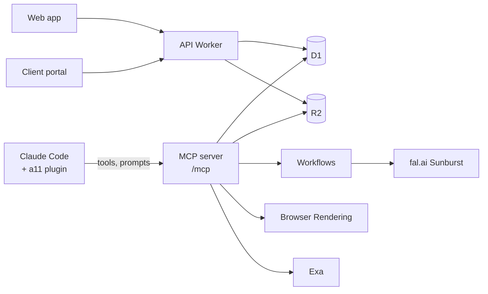

# Blueprint

The design of `a11-adgen`, version 2 (2026-11-06 SGT). It includes the owner's decisions D1 to D7 (`AGENTS.md` §4).

---

## 1. The idea in one line

Claude Code is the brain. Cloudflare is the hands. The owner picks 1 draft per idea in each batch (D2, second change, 07-11-2026) and judges the finished ads. He picks no ideas.

## 2. Parts

| Part | Job |
|---|---|
| **Claude Code + a11 plugin** (owner's laptop, owner's Claude plan) | All thinking: fact sheet, research, insights, ideas, copy, art direction, critique, image checks. Claude sees images that MCP tools return. |
| **MCP server** (Worker route `/mcp`, OAuth 2.1) | About 20 tools and 8 prompts. Each MCP prompt shows in Claude Code as a slash command. Prompts and the taste canon live on the server, so one update reaches every session. |
| **API + web app** (Worker `a11adgen`, static assets) | Brand kits, products, the batch board, the one human step, settings, spend. |
| **Client portal** (token link, no login) | View, comment, download the pack, upload results. |
| **D1** `a11adgen-db` | Brands, kit versions, products, facts, research, ideas, drafts, picks, canon, swipe file, results, spend. |
| **R2** `a11adgen-assets` | Images, packs, client uploads, the v1 export. |
| **Workflows** | fal render jobs with retries; a step waits for the fal result. |
| **Browser Rendering** | Later upgrade for `brand_extract` (screenshot, script-built sites). Today `brand_extract` uses a plain fetch. |
| **Cron Triggers** | Weekly client reminder for results; canon health check. |



The MCP server never calls an LLM (D1). Claude Code does not support MCP sampling, so Claude drives and calls the tools.

## 3. Pipeline

Legend: CLAUDE = Claude Code, CODE = Worker code, HAN = the owner, PAID = paid API.

| # | Step | Who | What happens |
|---|---|---|---|
| 0 | Brand kit | CODE, CLAUDE | `brand_extract` reads the home page source (fetch; Browser Rendering is a later upgrade): colours, fonts, logo candidates (header logo first, each file probed live) and icons, with a `missing` list. Only public https hosts are fetched. Claude writes voice, palette roles and "what this brand would never say". Kit is versioned. Claude checks that the logo reads the brand name. |
| 1 | Subject | HAN (input only) | Product URL, or brand only (no product), or redesign (picture links of a live ad). This is input, not a decision step. |
| 2 | Fact sheet | PAID Exa, CLAUDE | Exa `/contents` reads the page. Each fact keeps its source URL and exact quote: price, offer, pack size, proof. |
| 3 | Research | PAID Exa, CLAUDE | Exa search: Reddit, HardwareZone, reviews, competitor pages, Singapore moments. Optional later: Meta Ad Library through Apify (long-running ads are likely winners). |
| 4 | Insight sheet | CLAUDE | 8 to 12 buyer truths, each with its source. |
| 5 | Idea burst | CLAUDE writer | 20 to 30 ideas. Each = insight + visual idea + headline + funnel job. With results: 30% new angles, 50% big changes on winners, 20% small changes. With no results: all new. |
| 6 | Idea pick | CLAUDE critic | A separate critic subagent (fresh context) picks 3: one per funnel stage (tof, mof, bof), all different enough for Meta. The option B test and the owner gate first (`docs/creative-playbook.md` §2, `docs/taste-seed.md` §2). No human. |
| 7 | Drafts | PAID fal | 3 drafts per idea. `edit` endpoint, `quality: low`, 1024x1280, packshot and logo as references. |
| 8 | Draft check | CLAUDE, CODE | Claude looks at each draft. Code compares the read text with the approved copy. One fix edit per idea when needed. The critic reads `taste_log`, then ranks the drafts blind (`drafts_rank`). |
| 9 | Draft pick | HAN | Claude stops and shows the 3 drafts of each idea (chat or the board), with no rank. The owner picks 1 per idea, or none (D2, second change, 07-11-2026). Claude saves his pick with his words (`picks_save`) and starts the finals (`final_render`). |
| 10 | Final | PAID fal | `edit`, `quality: high`, 1536x1920, with the chosen draft as a reference so the layout stays. Claude checks the final once. |
| 11 | Pack | CODE, CLAUDE | Build the deliverable (§5). Publish the client link. |
| 12 | Results | CLIENT, CLAUDE | The client uploads Ads Manager screenshots, CSV files or `.xlsx` Excel files in the portal, up to 10 files at a time, each under 20 MB and 30 MB in all (the client downloads a Google Sheet as `.xlsx` or CSV first; or sends the files on WhatsApp and the owner drops them on the board). Claude reads CTR, CPC, spend per ad name. Baseline CTR comes from one screenshot at onboarding (D3). |
| 13 | Learn | CLAUDE | `/a11:learn` (with the plugin; without it, `/mcp__a11__learn`) reads new picks, notes and results. It changes the canon and the swipe file. It records each change with its evidence. The owner can undo any change on the board; no approval is needed (D2). |

## 4. Learning and self-curation

| Memory | Fed by | Used by | Curation |
|---|---|---|---|
| **Taste canon**: 20 to 40 rules in plain words | Owner final picks (picked = good, shown but not picked = weak bad), notes, results | Writer, critic, draft check (MCP resource) | Each rule keeps its evidence count and its hit rate on the owner's picks. No evidence in 60 days → retired. Max 40 rules. |
| **Swipe file**: real ads + why they work | Owner picks, client winners, v1 Used ads | Writer, as examples (never copy words or objects) | Top 3 per brand and per format. |
| **Results ledger**: one row per ad per report | Client screenshots and CSVs | Iteration mix (step 5), week report | Winner = above the client's baseline CTR with enough impressions. |

**Gold set.** v1 marks and notes on about 200 ads (D5) become a frozen test set. Before a canon or prompt change ships, the critic re-ranks the gold set. Balanced accuracy on the owner's marks must not fall by 0.04 or more; a smaller move is noise (`docs/decisions.md`, 2026-11-08). It runs in Claude Code, so it costs no API money.

**Signal check.** With one human step, the owner's pick is the main taste signal. The critic's rank is blind (the owner sees it only after he picks), so it cannot become a rubber stamp. `picks_save` and `taste_log` log how often his pick is the critic's rank 1. A low change rate with good client results is the target. A low change rate with bad results means the board hides the bad drafts; then show more.

## 5. Deliverable (weekly pack)

| Item | Detail |
|---|---|
| 4 finals | 4:5, 1536x1920, JPEG and PNG |
| Meta text | Primary text (first 125 characters show), headline (about 40 characters), description, CTA button; 2 variants each |
| Ad names | Fixed format, for example `a11_W46_catfiddle_b01_hook_c03_v1` (week, brand, the brand's batch number, stage, idea, version). The client uses these names, so results map back with no manual work. |
| Why each ad | One line: the buyer truth and its source |
| Launch plan | One ad set, all 4 ads, 72 hours, the kill rule |
| Fact check | Every claim and its source; HSA-safe note for health products |
| Week report (from week 2) | CTR vs baseline per ad, winners kept, what next week tries |
| Change a link in place | `pack_update` (built 09-11-2026): put the ads and the Meta text of a newer approved version into a link the client already has. The link, its ad names, the comments and the uploads stay. Ads match by stage and idea. Every change keeps the old content in `pack_updates`; `undo` puts it back. Owner, 09-11-2026: never revoke a link to replace its ads. |

## 6. MCP surface

| Group | Tools |
|---|---|
| Brand | `brand_extract` (built: fetch-based), `brand_get`, `brand_save_version` |
| Subject | `subject_save`, `facts_save`; redesign images are kept under `subjects/` and shown by `image_get` (`redesign_get` is not needed). `exa_contents` reads product-page text |
| Research | `exa_search`, `exa_contents`, `adlibrary_fetch` (later; paid, asks first) |
| Ideas | `ideas_save`, `ideas_pick_save` |
| Images | `render_drafts`, `render_edit`, `render_final`, `image_get` (returns the image) |
| Human step | `picks_save` (saves the owner's draft picks with his own words; the board saves the same picks) |
| Memory | `taste_log` (his picks and passes with the critic's rank), `canon_get`, `canon_update`, `swipe_add`, `swipe_search`, `gold_import`, `gold_get`, `gold_score`, `gold_runs` (all built in Phase 2a), `picks_get` (built 09-11-2026: picks with their finals, pack versions and next step), `baseline_save`, `results_save`, `results_get` (built in Phase 3b: the results ledger), `comments_get` (built in Phase 3b: the client's comments), `uploads_get`, `uploads_done` (built in Phase 3b: the client's results files) |
| Ops | `batch_status`, `spend_get`, `pack_publish`, `upload_link` (one-time upload of a repaired final or a skeleton, so agents need no admin token; built 09-11-2026), `final_attach`, `prompt_get` (the text of one prompt with its arguments filled in; each plugin short command calls it; built 09-11-2026), `pack_update` (newer approved ads into an existing client link, in place; built 09-11-2026, see §5) |

Prompts (slash commands) live on the server (`worker/prompts.ts`). With the plugin installed, type them as its short commands, `/a11:<name>` (added 09-11-2026: each file in `plugin/commands/` calls the `prompt_get` tool, so it runs the same server text). Claude Code also shows each MCP prompt as `/mcp__a11__<name>`; it sets that name and the server cannot change it. Without the plugin, use those names. The prompts: `brand`, `batch`, `final`, `learn`, `gold-test` (built in Phase 2b); `redesign` (built, with the redesign subject), `results` (built in Phase 3b) and `pack` (built 09-11-2026: the approved final per pick, box print for a boxed product, then `pack_publish`). Each is resumable; state lives in D1.

Plugin (in this repo, `plugin/`, installed once): subagents `writer`, `critic`, `art-director`, the short commands, plus the MCP config. Install: `/plugin marketplace add han669669/a11-adgen`, then `/plugin install a11@a11-adgen`. The plugin's MCP config has no token. The first time, Claude Code should open a browser: sign in with the web app account, then press Allow (not yet verified in Claude Code; the OAuth flow was tested end to end on the preview Worker). After that it renews the token by itself (1 hour access token, 30 day refresh token).

Connect without the plugin (an alternative; do not add it when the plugin is installed, because both name the server `a11`):

```bash
claude mcp add --transport http a11 https://a11adgen.gamingcomputing.workers.dev/mcp
```

Then run `/mcp` in Claude Code and choose a11 to sign in. For a script that cannot open a browser, the old bearer token still works: add `--header "Authorization: Bearer $A11_MCP_TOKEN"` and skip the sign-in.

## 7. Claude plan facts (checked 2026-11-06)

| Point | Status |
|---|---|
| Official Claude Code, logged in with the owner's plan, with a custom MCP server | Normal use. The server never holds the Claude login. |
| Third-party apps that reuse a subscription login | Not allowed (Anthropic, Feb 2026). Not used. |
| Agent SDK and `claude -p` on a plan | A separate capped credit was set for 15 Jun 2026, then paused. Can change. Phase 0 uses interactive Claude Code only. |
| Limits | 5-hour and weekly limits, shared with claude.ai. Usage per batch is not measured yet. |

## 8. Hard checks in code (budget 15)

1. Every price, number and offer in the copy matches the fact sheet text. Built in Phase 3a for the Meta text in `pack_publish` as a number check: every number must be in a fact's value or quote. A claim with no number ("free delivery") is checked by the critic against the fact sheet, not by code.
2. Painted text equals the approved copy (vision read, then code compares).
3. The logo reads the brand name.
4. No CTA button painted in the image.
5. Text inside the 4:5 frame with a margin.
6. Headline 7 words or fewer.
7. No price or saving on The Hook ad.
8. Race, ethnicity and religion words blocked unless the owner allows them.
9. Spend cap per batch and per month.
10. Owner-only paid actions.

## 9. Costs (estimates, not verified)

| Item | Per batch of 4 finals |
|---|---|
| Exa (about 25 searches + contents) | about US$0.20 |
| 12 low drafts with 2 references | about US$0.25 |
| 4 fix edits | about US$0.08 |
| 4 high finals at 1536x1920 with references | about US$0.40 |
| **Total paid APIs** | **about US$0.9 to 1.1** |
| Cloudflare | Free plan (US$0) |

Phase 0 measures the real fal cost at 1536x1920 high and the Claude usage per batch.

## 10. Build plan

| Phase | Scope | Done when |
|---|---|---|
| 0. Spike | Worker `a11adgen` with `/mcp` (OAuth stub or allow-list token), tools `exa_search`, `render_drafts`, `image_get`, `render_final`. One product, one idea, 3 drafts, 1 final. | Claude Code makes one 4:5 final end to end. Cost, Claude usage and time recorded. |
| 1. Core loop | Email + password auth with allow-list, full OAuth for MCP, D1 schema, brand kit, product / brand-only / redesign subjects, ideas, drafts, the final-pick board, finals. | One full batch of 4. Owner's pick recorded. |
| 2. Learning | Canon, swipe file, `/a11:learn`, critic subagent, v1 export → gold set. | Gold-set agreement measured before and after one canon change. |
| 3. Client side | Pack, client portal, ad names, results upload and read, baseline, week report. | One real client week: pack sent, results read back. Code built; the real week waits for the first paying client (owner, 09-11-2026, `docs/backlog.md`). |
| 4. Growth (later) | Meta Ad Library research (Apify), Exa Websets prospect lists, 9:16 extension. | Owner asks for it. |

## 11. Open points

| Point | Status |
|---|---|
| `main` branch | Created 2026-11-06 (owner yes). The GitHub default branch is `main` (owner confirmed 07-11-2026). |
| First real client | Pending: no paying client yet (owner, 09-11-2026). Cat & the Fiddle (https://www.catandthefiddle.com/), product Fickle Feline 2.0 Cheesecake (owner, 07-11-2026), is a test brand used to refine the tool; nothing is sent to it. v1 made ads for this product too, and the owner's marks on them are in the gold set. |
| MCP auth | OAuth 2.1 (owner, 07-11-2026: "safety first", take the agent's recommendation). Built 07-11-2026 with one free KV namespace (`a11adgen-oauth`). The old bearer token still works for scripts. |
| Studio site (a11studio.pro) | Not touched by this repo's agents. Another agent handles it and the owner decides its copy (owner, 07-11-2026). |
| Cloudflare plan | Workers Free (owner, 2026-11-06). Limits in `AGENTS.md` §6. |
| Cloud session network | Unrestricted. The Worker calls fal and Exa, not the session. |
| fal `edit` at high keeps the draft's layout | Not verified. Phase 0 tests it. |
| Auth library on Workers (Better Auth with D1, or a small own implementation) | Decided 2026-11-07: small own implementation (`docs/decisions.md`). |
