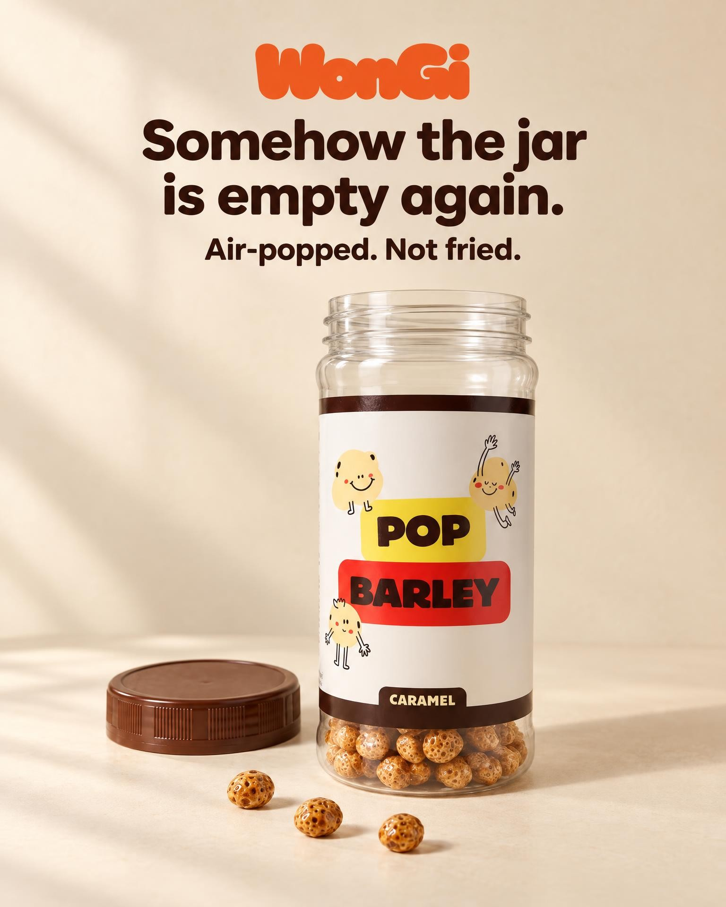

# Phase 0 results (2026-11-07 SGT)

One 4:5 ad, made from start to finish through the `a11adgen` MCP server. Claude (in a Claude Code cloud session) did the thinking. The Worker did the paid calls.

## 1. The ad

| Item | Value |
|---|---|
| Brand / product | WonGi, Caramel Pop Barley jar, S$8.90 (wongi.sg) |
| Format | The Hook (cold buyers, no price) |
| Headline | "Somehow the jar is empty again." |
| Tagline | "Air-popped. Not fried." (true: the product page says "Not fried") |
| Insight | The brand's own words: "the bottle will be empty before you realize". |
| Visual | The real jar, open and almost empty; one lid beside it; three kernels in front |
| Final | 1536x1920, JPEG, 217 KB |

## 2. Steps and numbers

| Step | Tool | Time | Est. cost (US$) |
|---|---|---|---|
| Find a product | `exa_search` (lite) | seconds | 0.004 |
| Read the product page | `exa_contents` | seconds | 0.001 |
| Pack photo + logo | Shopify product JSON + home page header (free) | seconds | 0 |
| Buyer research | `exa_search` x2 (lite) | seconds | 0.008 |
| Ideas + critic pick | Claude | minutes | 0 |
| 3 drafts, low, 1024x1280, 2 references | `render_submit` | about 25 s | 0.041 |
| Draft check | `image_get` + Claude | seconds | 0 |
| Final, high, 1536x1920 | `render_submit` | about 60 s | 0.083 |
| **Total for the shipped ad** | | | **about 0.14** |
| Ledger total, incl. 2 failed finals | | | 0.323 |

The ledger counts estimates, not fal's bill. One failed final (HTTP 422) may not be billed by fal: not verified.

Not measured: Claude plan usage for the session (the session also built the code).

## 3. What went wrong and the fix

| # | Problem | Cause | Fix |
|---|---|---|---|
| 1 | fal refused the chosen draft as a reference (HTTP 422, "URL not accessible") | The `/m/` media route answered HEAD with 404; fal checks a URL with HEAD | `/m/` answers GET and HEAD (tests added) |
| 2 | The first high final showed a **full jar with its lid on, plus a second lid** | The real pack photo (full jar, lid on) was a reference; at high quality the model copied its state over the draft | For the final, pass the chosen draft (and the logo) only. The draft already carries the true pack. State the scene condition in words. |

Lesson 2 is a rule for the pipeline: **a reference image carries its state.** When the scene changes the product's state (open, empty, poured, cut), do not pass a reference that shows another state at the final step.

## 4. What Phase 0 proved

- Claude Code + a hand-written MCP server on the Workers Free plan works end to end.
- fal `edit` with references keeps the real label, characters and logo at low and high quality.
- Low drafts are fast (about 25 s for 3) and cheap, so 3 drafts per idea is affordable.
- The critic step catches real defects that a person would reject (a contradicting picture, a doubled object).

## 5. fal facts (owner's paste of the fal docs, 2026-11-07)

| Fact | Effect |
|---|---|
| Endpoints `openai/gpt-image-2.5/sunburst/text-to-image` and `/edit` | We use `/edit` (references) through the queue API |
| `image_urls`: up to 16 references | Pack, logo, chosen draft |
| `num_images`: 1 to 10 | Our tool allows 3 for drafts |
| `mask_url`: white = edit, black = keep | Use for local fixes (text-fix, logo-fix) in Phase 1, instead of a whole-image re-render |
| `quality`: auto, low, medium, high, xhigh, max | Drafts `low`, finals `high`; never `auto` (cost can reach `max`) |
| Sizes: multiples of 16, max edge 3840, 655,360 to 8,294,400 pixels | 1024x1280 and 1536x1920 are valid |
| Pricing by token: text in US$5/M, image in US$8/M, image out US$30/M | Estimates in `worker/spend.ts` |
| A reference URL must be publicly reachable (HEAD and GET) | See problem 1 |
